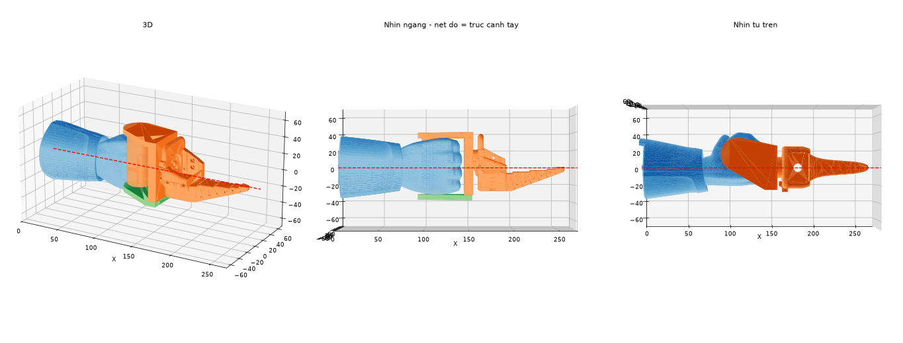

# Gripper SO101 đồng trục với cánh tay Unitree R1

Bàn tay R1 (`right_wrist_roll_link.STL`) là một nắm đấm có **lỗ trụ xuyên Ø30 mm**.
Một **khung chữ U** ôm lấy nắm tay, có tay cầm cắm vào lỗ đó.
Gripper SO101 bắt vào mặt trước của khung và **chĩa thẳng ra trước theo cẳng tay**.
Điểm hai mũi kẹp chạm nhau nằm đúng trên trục cánh tay (trục khớp xoay cổ tay), nên khi cổ tay xoay, mũi kẹp chỉ xoay tại chỗ.



```
 nhìn ngang         tấm trên ┌──────────┐
                     ┌───────┤ tay cầm  │▌ tấm trước
 cẳng tay ══════════ │ nắm   │  Ø29.2   │▌──[motor]──╲
 (trục) - - - - - - -│ tay   │ (trong   │▌            ●  ← mũi kẹp, nằm trên trục
                     └───────┤   lỗ)    │▌──[hàm cố định]╱
                    tấm dưới └──────────┘ ← 1 bu lông M5 + 2 vít M4
```

- Hàm kẹp mở **lên/xuống**: hàm cố định ở dưới, motor và hàm di động ở trên.
- Mũi kẹp cách mặt trước nắm tay khoảng 114 mm, tại vị trí X ≈ 257 mm trong hệ tọa độ link.
- Khung ôm trọn nắm tay, nên gripper không xoay hay lắc quanh tay cầm.

## File (thư mục `output/`)

| File | Dùng để |
|---|---|
| `r1_fit_test_plug.stl` | **In cái này trước.** Gồm 3 bậc Ø28.8 / 29.2 / 29.6 để cắm thử vào lỗ nắm tay. Chọn đường kính vừa nhất rồi sửa `HANDLE_D`. |
| `r1_u_bracket.stl` | Khung U gồm tấm trên, tay cầm và tấm trước. Bắt follower SO101 gốc vào mặt trước bằng 4 vít M3. |
| `r1_u_bracket_with_so101_jaw_onepiece.stl` | Phương án khác: khung U in liền với hàm cố định SO101 (`wrist_roll_follower`), không cần 4 vít M3. |
| `r1_u_bottom_plate.stl` | Tấm dưới (rời). |
| `assembly_preview.stl` / `.png` | Chỉ để xem cụm lắp trên tay R1, không in. |

Phần còn lại lấy nguyên từ SO101: `moving_jaw_so101_v1.stl`, motor STS3215 và vít của motor.

## Vật tư
- 1 bu lông M5×25 và 1 đai ốc M5 (khóa tay cầm)
- 2 vít M4×16 tự ren (tấm dưới vào chân tấm trước)
- 4 vít M3×10 tự ren (follower vào khung; bản liền khối không cần)

## Lắp
1. Luồn đai ốc M5 vào rãnh ngang trong tay cầm (cách đầu tay cầm 15 mm).
2. Lắp gripper SO101 vào mặt trước khung: motor, hàm di động, rồi 4 vít M3.
   Vít M3 vặn từ trong ổ motor ra, giống hệt cách SO101 bắt vào horn của motor cổ tay.
3. Hạ khung từ trên xuống: tay cầm vào lỗ nắm tay (từ phía ngón cái), tấm trước nằm trước đốt ngón tay.
4. Áp tấm dưới vào từ phía ngón út. Siết bu lông M5 vào tay cầm, rồi siết 2 vít M4 vào chân tấm trước.

## In
- **Khung U:** đặt tấm trên úp xuống bàn in, tay cầm và tấm trước dựng đứng lên. Như vậy không cần support.
  Vật liệu PETG hoặc PLA+, 4–5 lớp vỏ, infill 40% trở lên.
- **Bản liền khối:** cần support cho phần hàm kẹp.
- Muốn đổi thông số thì sửa phần `THAM SỐ THIẾT KẾ` trong `make_r1_gripper.py`, rồi chạy lại:

```powershell
python make_r1_gripper.py
```

Các tham số hay chỉnh:
- `HANDLE_D`: đường kính tay cầm.
- `TIP_SHIFT_Z`: dịch điểm mũi kẹp lên hoặc xuống so với trục.
- `FRONT_GAP`: khe giữa đốt ngón tay và tấm trước.

## Lưu ý
- Kích thước lấy từ STL của URDF (lưới khá thô). Cần in test plug và kiểm tra trên robot thật trước khi in khung.
- Trục cánh tay được lấy là trục X của link (trục khớp wrist roll). Thân cẳng tay trong STL lệch khỏi trục này khoảng 1.5 mm.
- Vị trí mũi kẹp tính theo **hàm cố định** (mặt kẹp trong, gần đầu mũi), tức là điểm hàm di động chạm vào khi đóng hẳn. Khi gripper mở, vật được kẹp sẽ hơi lệch lên trên trục.
  Nếu muốn tâm vật (ví dụ vật dày 20 mm) nằm đúng trục, đặt `TIP_SHIFT_Z = -10`.
- Hàm di động và motor không được mô phỏng (vì không có URDF của SO101). Chúng giữ nguyên vị trí tương đối với follower như trên SO101 gốc.
